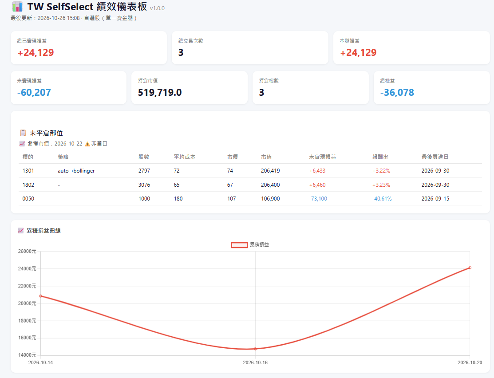

# TW SelfSelect Trader — 台股「自選股」量化自動交易系統

> 每月自動選股、依策略訊號自動進出、自動下單的台股交易機器人。
> 由 [tw-autotrader](https://github.com/dinchentech/tw-autotrader) 拆出，**只有一條資金腿：每月選股的自選股**。

📖 **[使用手冊](使用手冊.md)** — 安裝、`.env` 設定、每月作業、儀表板、真錢上線檢查清單
🧠 **[策略說明](策略說明.md)** — 選股原理、四支策略、型態路由、風控、參數總表、**回測數字出處（附錄 K）**
📈 **[線上儀表板](https://dinchentech.github.io/tw-selfselect/)** — 交易日收盤後自動更新

---

## ⚠️ 免責聲明

本軟體係依「現狀（AS-IS）」提供，不帶有任何形式的明示或暗示之保證（包括但不限於對適銷性、特定目的之適用性以及不侵權的暗示保證）。
開發團隊在任何情況下，均不對因使用或無法使用本軟體所引起的任何直接、間接、偶發、特殊、懲罰性或衍生性損失（包括但不限於利潤損失、業務中斷、資料遺失、設備損壞或電腦故障）承擔任何法律及賠償責任。
**使用者須自行承擔使用本軟體之所有風險；本專案不構成任何投資建議。回測績效不代表未來實績。**

預設為 **`ESUN_ENVIRONMENT=simulation`（模擬帳戶）**。切到 `real` 之前，請完整跑過
[使用手冊](使用手冊.md) §8「真錢上線檢查清單」 的每一項。

---

## 我們的做法（最高原則：增加你的獲利）

1. **選股選得出好的股就買**：每月 D1 盤後選股，D2 13:25–13:30 進場，買進後由該股鎖定的策略管理出場。
2. **選不到夠好的就買 0050**：名單建倉完成後，閒置資金停泊在 0050（`SELFSELECT_PARK_ASSET`，預設 0050），
   要買股票前自動全部釋出。錢不留著空轉，也不硬買不夠標準的股票。
3. **「單一策略打不打得贏 0050」不是重點**：整體獲利最高才是。所以我們不追求每支策略都有超額報酬，
   而是讓可用資金持續在「名單」與「0050」之間有效率地工作。

**只提醒你三件事**

1. **投資都有風險**：這是動能型策略，回測最大回撤 −53%～−57%（2022 年單年 −24%）。請先確認你承受得住。
2. **回測不代表實盤**：滑價、部分成交、資料快照、參數挑選偏誤都會讓實盤比回測差（細節見[備註](#備註)）。
3. **先用模擬帳跑 2–3 個月，再換真錢**：把選股、下單、通知、帳務都看過一輪，再切 `ESUN_ENVIRONMENT=real`。

---

## 這是什麼？

| 項目 | 說明 |
|---|---|
| 選股 | 每月第 1 個交易日（D1）盤後自動選股：誠實候選池（歷史市值前 N 大，無倖存者偏差）→ 動能／技術面／穩定性評分 → 法人確認 → 過熱剔除 → 取前 N 檔。**已持有的一律保留**，所以滿倉（N 檔都在手上）的月份不會主動換股 |
| 執行 | 每月第 2 個交易日（D2）13:25–13:30 自動買進新名單；**已持倉一律保留，持倉未滿 N 檔才補入新標的**（滿倉時不換股）；賣出後由該股進場當下鎖定的策略管理 |
| 風控 | 大盤年線過濾、帳戶回撤保護（MIN_DRAW_BACK）、買入當下過熱閘門、每日交易次數／虧損上限、滿倉不重複買 |
| 券商 | 玉山證券（E.Sun SDK：行情＋交易）；另有凱基（mock／實單）介面 |
| 通知 | Telegram（下單、選股、持倉報告、異常告警），可選 LINE Notify |
| 儀表板 | 交易日 13:45 產生 `logs/dashboard.html`；`DASHBOARD_PUBLISH=1` 時 13:50 自動推上 GitHub Pages |
| 部署 | Docker（`docker compose up -d --build`）；雲端建議 GCP e2-micro 之類的便宜 VM |

## 快速開始

```bash
# 1) 環境（Python 3.11；玉山 SDK 只支援特定版本，建議照 requirements.txt 安裝）
python -m venv .venv
.venv/bin/pip install -r requirements.txt

# 2) 設定
cp .env.example.txt .env      # 填入 FINMIND_API_TOKEN / 券商金鑰 / Telegram
vi .env                       # 確認 PC_ 名單與 TOTAL_CAPITAL

# 3) 先手動跑一次選股（dry-run，不會寫任何檔）
.venv/bin/python scripts/monthly_selfselect_run.py --risk normal --top-n 5

# 4) 補齊候選池資料（第一次必做）
.venv/bin/python scripts/rebuild_mcap_ranking.py
.venv/bin/python scripts/build_historical_shares.py

# 5) 跑測試
.venv/bin/python -m unittest discover -s test -p 'test_*.py'

# 6) 啟動（模擬帳戶）
.venv/bin/python selfselect_trader.py
```

Docker：

```bash
cp .env.example.txt .env       # 先填好
docker compose up -d --build
docker compose logs -f         # 看主迴圈
```

## 每月作業（一句話）

**`SELFSELECT_AUTO=1`（VM 現行設定）⇒ 程式自己在 D1 盤後選股、改 `.env`、發 Telegram，平常不需要手動跑任何指令**；
你只要在 D2 13:25 前看過名單、想改再改 `.env` 即可。

只有 `SELFSELECT_AUTO=0`、想先預覽名單、或想剔除幾檔時，才需要跑下面兩行：

```bash
.venv/bin/python scripts/monthly_selfselect_run.py --risk normal --top-n 5            # 預覽（不寫檔）
.venv/bin/python scripts/monthly_selfselect_run.py --risk normal --top-n 5 --apply    # 寫入 .env（自動備份）
```

完整 SOP 見[使用手冊](使用手冊.md) §3「每月作業」。

## 架構

```
selfselect_trader.py     主程式：主迴圈 / 訊號判定 / 下單 / 記帳 / 通知
core/
  selfselect_scheduler.py  每月自動選股排程（D1 選股、D2 補跑）
  config_loader.py         PC_<代號> 設定解析（.env 是唯一真相）
  risk_manager.py          風控（每日次數/虧損、漲跌停檢查）
  drawdown_guard.py        MIN_DRAW_BACK 回撤保護 + 總資產口徑
  books.py                 三本帳（performance.csv／holdings／分帳本）稽核
  live_utils.py            下單成交確認、時段窗、報告節流等共用工具
  live_broker.py           券商工廠（esun / kgi）
  trading_calendar.py      台灣交易日曆（含國定假日、補班日）
  candidate_pool.py        誠實候選池（歷史股本 × 當期價格）
  inst_data.py             TWSE 法人／FinMind 股價資料層（含版本化快取）
  cache_io.py              快取讀寫（schema 版本化）
data/
  esun_provider.py         玉山 SDK 封裝（行情 + 下單）
  yahoo_loader.py          yfinance 日線
strategies/                策略函式（auto 型態分派 / ma_cross / bollinger / vwap / breakout / keep_wait）
scripts/
  monthly_selfselect_run.py   每月作業一條指令（補資料 → 選股 → 改 .env → 可選同步到 VM）
  monthly_rebalance_picker.py 選股引擎（兩種風險組 normal／high_profit、法人確認、過熱剔除）
  stock_selector_grid.py      選股共用函式庫（資料載入／特徵／評分）
  backtest_plan2_monthly_3group.py  每月換股策略回測（含交易成本、誠實池）
test/                      單元測試（unittest）
```

## 📊 儀表板



由 `scripts/generate_dashboard.py` 產生單檔 `logs/dashboard.html`：上排是已實現／未實現損益與持倉市值，
中間是未平倉部位（含該檔進場當下鎖定的策略），下面是**已實現損益**逐日累積曲線（FIFO、含手續費與證交稅）。

- 交易日 **13:45** 產生；`DASHBOARD_PUBLISH=1` 時 **13:50** 自動推上 GitHub Pages（預設 `0`＝不公開）。
- 發佈設定（deploy key）、線上頁面停更的排查步驟 → [使用手冊 §5-3](使用手冊.md#5-3-儀表板公開頁可選預設關閉)。

## 回測績效

**預設口徑＝實盤口徑**：`PROFILE=default`（zscore 評分＋大盤年線＋停泊 0050）＋`PRESET=revenue`（池 100＋營收因子）
＋`STRAT_MODE=form`（＝實盤 `auto` 型態路由）＋`IMM_OVERHEAT=1`＋選股端過熱過濾；TOP5、每月換股、NT$1,000,000、
含手續費 0.1425%＋證交稅 0.3%。

| 期間 | 停泊 0050（＝我們要的用法） | 年化 | MDD | 夏普 | 對照：完全不停泊 | 年化 | MDD | 夏普 | 0050 買進持有 |
|---|---:|---:|---:|---:|---:|---:|---:|---:|---:|
| 2016-04-01～2026-10-23（最長可用） | +1445.2% | +29.60% | −56.7% | 1.17 | +656.9% | +21.13% | −52.8% | 1.02 | +793.4%／−34.0%／1.17 |
| 2022-01-01～2026-10-23（近年） | +283.1% | +32.23% | −33.4% | 1.18 | +161.1% | +22.10% | −26.0% | 1.06 | +231.4%／−34.0%／1.21 |

這張表要看的不是「策略 vs 0050 誰贏」，而是「資金有沒有持續在工作」：

- 左欄＝**選股 ＋ 閒置資金停泊 0050**，也就是上面「我們的做法」第 2 點；**v1.1.15 起實盤預設就是這樣跑**。
  不想停泊請設 `SELFSELECT_PARK_ASSET=`（留空），就會變成中間那兩欄。
- 沒有停泊時資金會空轉，報酬自然低一截（+788pp／+122pp）——這是**配置問題，不是選股或策略的成敗**。
- 數據細節（與 0050 逐年比較、夏普／回撤解讀、walk-forward、資料快照、三輪實驗）→ [備註](#備註)與
  [策略說明](策略說明.md) 附錄 K「回測研究紀錄（數字出處）」；preset 與停泊怎麼設 → [使用手冊](使用手冊.md) §3-0c／§3-0d。

重跑（這就是預設口徑）：

```bash
PRESET=revenue PROFILE=default GROUPS_ONLY=normal \
  STRAT_MODE=form IMM_OVERHEAT=1 ENTRY_OVERHEAT=1 \
  START=2016-04-01 END=2026-10-23 TOP_N=5 INITIAL=1000000 \
  .venv/bin/python scripts/backtest_plan2_monthly_3group.py
```

## 資料來源與授權

- 股價：FinMind、yfinance（Yahoo Finance）、TWSE 公開資料。
- `cache/` 內的快取檔**不進版控**（可由程式重建，且屬於第三方資料，不散布）。
- 本專案程式碼為**專有授權**（僅供個人學習／研究／學術使用；商業使用須經原作者書面授權，見 [LICENSE](LICENSE)）；第三方資料請遵守其各自授權條款（FinMind 有配額與使用限制）。

## 版權聲明

本專案（TW SelfSelect）僅供個人學習、研究與學術使用。

未經原作者（dinchentech）書面明確授權，嚴格禁止：

1. 將本系統之全部或部分原始碼進行商業販售、出租或轉讓。
2. 將本系統包裝為付費軟體、付費雲端服務或訂閱制產品。
3. 利用本專案進行任何直接或間接獲取商業利益之行為。

### 部署授權（要不要買授權的判準）

- **只在券商模擬環境跑、不實際向券商下單**：不用購買授權（可自由學習、研究、驗證策略）。
- **要在個人實際佈署、並真的向券商下單**：請先購買授權 → <https://www.ruten.com.tw/item/22644070525074/>

### 其他

- 允許個人學習／研究／學術使用，以及在不涉及商業利益前提下修改與分享（須保留授權聲明）。
- 第三方套件、SDK 與資料來源（FinMind、玉山 SDK、TWSE 等）不在本授權範圍，請遵守其各自條款。
- 完整條文：[LICENSE](LICENSE)
- **商業使用／授權洽詢**：`frank@dinchen.com.tw`（主旨請註明「TW SelfSelect 商業授權」）。

## 備註

1. **想跟 0050 逐項比，看這裡**（數據，不是結論）：「實盤口徑」與「輪替四策略口徑」差別很大——同批選股在 `aggressive` 上差 397pp
   （那是 2016-2025 的數字；**近窗 2022 起輪替反而略遜實盤、與 0050 只是打平**，見[策略說明](策略說明.md) §6.7 補充）。
   2016-04 起：停泊 **+1445.2%／夏普 1.17／MDD −56.7%**（0050 +793.4%／1.17／−34.0%）；完全不停泊 **+656.9%／1.02／−52.8%**
   （**總報酬與夏普都輸 0050**，因為資金空轉）。2022 起：停泊 +283.1%／1.18／−33.4%、不停泊 +161.1%／1.06／−26.0%、0050 +231.4%／1.21／−34.0%。
   口徑定義、逐年拆解、全部實驗與數字出處：[策略說明](策略說明.md) 附錄 K.1／K.3。
2. **停泊 0050 是放大器，不是穩定器**：主表一半報酬來自它（+788pp／+122pp），多頭年幫很大（2024 +25.2pp）、
   空頭年幫倒忙（2022 −15.7pp，該年 0050 −21.2%）。規則、副作用與怎麼關掉：[使用手冊](使用手冊.md) §3-0d。
3. **預設值是在同一段歷史上挑出來的**：三個 preset（含現任預設 `revenue`）都是 2016-2025 上 16 組實驗事後選的；
   walk-forward 六輪挑中三組、訓練段領先第二名最小只有 +0.00 夏普 ⇒ 判定「**尖峰不是平台**」，
   超額報酬仍有相當比例是選擇偏誤。OOS 逐年串接 +372.1% vs 0050 +206.4%（3 勝 3 敗）。逐年表在[策略說明](策略說明.md) 附錄 K.6。
4. **結果對資料覆蓋率很敏感**：月營收快取 515 → 645 檔時，同一格（輪替口徑）從 +1070.5% 變 +1323.6%（差 253pp）。
   本頁與[策略說明](策略說明.md) 附錄 K 的數字共用同一份資料快照：宇宙 672 檔（610 存活＋62 已下市）、PER 672/672、月營收 645/672。
5. **主表為什麼從 2016-04-01 起算**：2015 年的個股日線快取幾乎沒有（681 檔只有 63 檔有 2015），候選池是空的
   （實測 `pool=0`），池第一次滿 150 檔是 2016-03-31。要真的做 2015 是資料工程，不是改參數。見[策略說明](策略說明.md) 附錄 K.1。
6. **改進空間（誠實清單）**：選股池與評分方式綁死、因子只有動能＋評價＋月營收、法人／新聞資料缺口、
   出場機制單薄、成本未計滑價、驗證強度不足 → 完整表格與下一步在[策略說明](策略說明.md) 附錄 K.12。
7. **研究性質的比較不放在首頁**：程式自選 vs AI 名單（池 20）、LLM 判斷 vs z-score 公式、母專案 tw_autotrader 的
   8 檔自選股回測 → [策略說明](策略說明.md) 附錄 K.10／K.18／K.19。
8. **參數的唯一真相**：`.env.example.txt`（每個鍵的預設值與說明）＋[策略說明](策略說明.md) §14「`.env` 參數分組總表」；
   README 不重複列參數，避免三份文件各講一套。
9. **玉山 SDK（`esun_marketdata` / `esun_trade`）不在 PyPI**，需向玉山證券申請 whl 後放進 `esun_sdk/`。
   沒有 SDK 時仍可跑回測與選股（只用到 FinMind／yfinance），但**無法下單**。
10. **儀表板截圖**是 2026-10-26 的模擬帳戶快照；自己跑一段時間後，`logs/dashboard.html` 才是你的版本
   （要換這張圖，直接把新截圖覆蓋 `plans/assets/dashboard_real_20261026.png`）。
