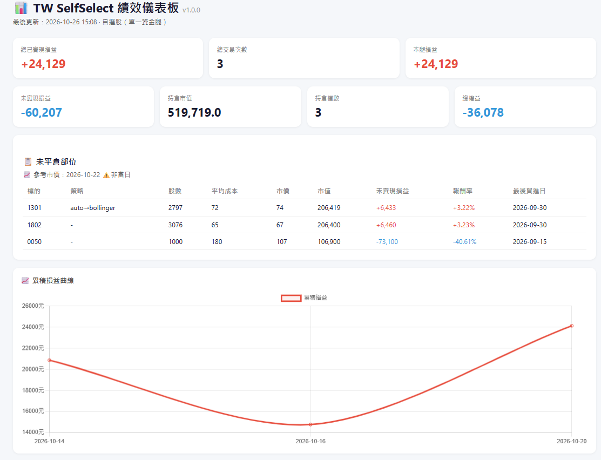

# TW SelfSelect Trader — 台股「自選股」量化自動交易系統

> 每月自動選股、自動換股、自動下單的台股交易機器人。
> 由 [tw-autotrader](https://github.com/dinchentech/tw-autotrader) 拆出，**只有一條資金腿：每月換股的自選股**。

📖 **[使用手冊](使用手冊.md)** — 安裝、參數、每月作業、真錢上線檢查清單
📊 **[線上儀表板](https://dinchentech.github.io/tw-selfselect/)** — 由 VM 在每個交易日收盤後自動更新（13:45 產生 `logs/dashboard.html`、13:50 推上 GitHub Pages）；要不要公開由 `.env` 的 `DASHBOARD_PUBLISH` 決定，預設 `0`＝不公開（見[使用手冊 §5-3](使用手冊.md#5-3-儀表板公開頁可選預設關閉)）　·　📊 **[策略說明](策略說明.md)** — 策略原理、選股口徑、風控、參數總表

---

## ⚠️ 先讀這段（免責聲明）

本軟體係依「現狀（AS-IS）」提供，不帶有任何形式的明示或暗示之保證（包括但不限於對適銷性、特定目的之適用性以及不侵權的暗示保證）。
開發團隊在任何情況下，均不對因使用或無法使用本軟體所引起的任何直接、間接、偶發、特殊、懲罰性或衍生性損失（包括但不限於利潤損失、業務中斷、資料遺失、設備損壞或電腦故障）承擔任何法律及賠償責任。
**使用者須自行承擔使用本軟體之所有風險；本專案不構成任何投資建議。** 回測績效不代表未來實績。

預設設定為 **`ESUN_ENVIRONMENT=simulation`（模擬帳戶）**。切到 `real` 之前，請完整跑過
[使用手冊 §真錢上線檢查清單](使用手冊.md#真錢上線檢查清單) 的每一項。

---

## 這是什麼？

| 項目 | 說明 |
|---|---|
| 選股 | 每月第 1 個交易日（D1）盤後自動選股：誠實候選池（歷史市值前 N 大，無倖存者偏差）→ 動能／技術面／穩定性評分 → 法人確認 → 過熱剔除 → 取前 N 檔 |
| 執行 | 每月第 2 個交易日（D2）13:25–13:30 自動買進新名單；持股依策略訊號進出，進場當下鎖定型態對應的策略 |
| 風控 | 大盤年線過濾、帳戶回撤保護（MIN_DRAW_BACK）、買入當下過熱閘門、每日交易次數／虧損上限、滿倉不重複買 |
| 券商 | 玉山證券（E.Sun SDK：行情＋交易）；另有凱基（mock／實單）介面 |
| 通知 | Telegram（下單、選股、持倉報告、異常告警），可選 LINE Notify |
| 儀表板 | `scripts/generate_dashboard.py` 產生 `logs/dashboard.html`；VM 每交易日 13:45 產生、13:50 自動推上 GitHub Pages（`DASHBOARD_PUBLISH=1` 才啟用） |
| 部署 | Docker（`docker compose up -d --build`）；雲端建議 GCP e2-micro 之類的便宜 VM |

## 📊 儀表板



由 `scripts/generate_dashboard.py` 產生單檔 `logs/dashboard.html`（圖表用 Chart.js CDN；本機可直接開，沒網路時只有圖表抓不到）：

- **上排數字**：已實現損益、交易次數、本腿損益、未實現損益、持倉市值、持倉檔數、總損益
- **未平倉部位**：標的／策略／股數／平均成本／市價／市值／未實現損益／報酬率／最後買進日（「策略」欄＝該檔進場當下鎖定的策略，`auto` 會顯示實際路由到的策略）
- **累積損益曲線**：**已實現**損益逐日累積（FIFO 配對、已含手續費與證交稅；未實現損益只在上排數字與「未平倉部位」表）
- 排程：VM 每交易日 **13:45** 產生（`logs/dashboard.html`）；若 `.env` 設 `DASHBOARD_PUBLISH=1`，**13:50** 自動推上 GitHub Pages → [線上儀表板](https://dinchentech.github.io/tw-selfselect/)（預設 `0`＝不公開，見[使用手冊 §5-3](使用手冊.md#5-3-儀表板公開頁可選預設關閉)）
- 自動發佈的憑證建議用 **deploy key**（ed25519、只對這個 repo、**不會過期**；有 `~/.dash-deploy-key` 就走 SSH，沒有才退回 PAT），設定見[使用手冊 §5-3](使用手冊.md#5-3-儀表板公開頁可選預設關閉)。
- 臨時補救（VM 沒憑證時）：把 VM 的 `~/tw-selfselect/logs/dashboard.html` 抓回覆蓋 `docs/index.html` 再 `git push`，Pages 1–2 分鐘後更新（步驟見[使用手冊 §5-3](使用手冊.md#5-3-儀表板公開頁可選預設關閉)）。
- ⚠️ 線上頁面若停在舊日期／數字全 0：先看 VM 的 `~/tw-selfselect/logs/publish_dashboard.log`。最常見是 **`~/.dash-publish-token` 為空**（`⏭ token 檔為空 ⇒ 跳過`）⇒ 依[使用手冊 §5-3](使用手冊.md#5-3-儀表板公開頁可選預設關閉) 重新寫入 PAT，再手動跑一次 `/usr/local/bin/publish_dashboard.sh`。
- 上圖為 **2026-10-26 模擬帳戶**快照（含持倉代號與金額）；自己跑一段時間後，把 `logs/dashboard.html` 用瀏覽器打開就是你的版本，要換這張圖直接把新截圖蓋掉 `plans/assets/dashboard_real_20261026.png` 即可

## 架構

```
selfselect_trader.py     主程式：主迴圈 / 訊號判定 / 下單 / 記帳 / 通知
core/
  selfselect_scheduler.py  每月自動選股排程（D1 選股、D2 補跑）
  config_loader.py         PC_<代號> 設定解析（.env 是唯一真相）
  risk_manager.py          風控（每日次數/虧損、漲跌停檢查）
  drawdown_guard.py        MIN_DRAW_BACK 回撤保護 + 總資產口徑
  books.py                 三本帳（performance.csv／holdings／分帳本）稽核
  live_utils.py            下單成交確認、時段窗、報告節流等共用工具
  live_broker.py           券商工廠（esun / kgi）
  trading_calendar.py      台灣交易日曆（含國定假日、補班日）
  candidate_pool.py        誠實候選池（歷史股本 × 當期價格）
  inst_data.py             TWSE 法人／FinMind 股價資料層（含版本化快取）
  cache_io.py              快取讀寫（schema 版本化）
data/
  esun_provider.py         玉山 SDK 封裝（行情 + 下單）
  yahoo_loader.py          yfinance 日線
strategies/                策略函式（auto 型態分派 / ma_cross / bollinger / vwap / breakout / keep_wait）
scripts/
  monthly_selfselect_run.py   每月作業一條指令（補資料 → 選股 → 改 .env → 可選同步到 VM）
  monthly_rebalance_picker.py 選股引擎（兩種風險組 normal／high_profit、法人確認、過熱剔除）
  stock_selector_grid.py      選股共用函式庫（資料載入／特徵／評分）
  backtest_plan2_monthly_3group.py  每月換股策略回測（含交易成本、誠實池）
test/                      單元測試（unittest）
```

## 快速開始

```bash
# 1) 環境（Python 3.11；玉山 SDK 只支援特定版本，建議照 requirements.txt 安裝）
python -m venv .venv
.venv/bin/pip install -r requirements.txt

# 2) 設定
cp .env.example.txt .env      # 填入 FINMIND_API_TOKEN / 券商金鑰 / Telegram
vi .env                       # 確認 PC_ 名單與 TOTAL_CAPITAL

# 3) 先手動跑一次選股（dry-run，不會寫任何檔）
.venv/bin/python scripts/monthly_selfselect_run.py --risk normal --top-n 5

# 4) 補齊候選池資料（第一次必做）
.venv/bin/python scripts/rebuild_mcap_ranking.py
.venv/bin/python scripts/build_historical_shares.py

# 5) 跑測試
.venv/bin/python -m unittest discover -s test -p 'test_*.py'

# 6) 啟動（模擬帳戶）
.venv/bin/python selfselect_trader.py
```

Docker：

```bash
cp .env.example.txt .env       # 先填好
docker compose up -d --build
docker compose logs -f         # 看主迴圈
```

> 玉山 SDK（`esun_marketdata` / `esun_trade`）**不在 PyPI**，需向玉山證券申請 whl 後放進 `esun_sdk/`。
> 沒有 SDK 時仍可跑回測與選股（只用到 FinMind／yfinance），但無法下單。

## 每月作業（一句話）

```bash
.venv/bin/python scripts/monthly_selfselect_run.py --risk normal --top-n 5            # 預覽
.venv/bin/python scripts/monthly_selfselect_run.py --risk normal --top-n 5 --apply    # 寫入 .env（自動備份）
```

開啟 `SELFSELECT_AUTO=1` 後，主程式會在 D1 盤後自己做（並發 Telegram 通知），
你只要在 D2 13:25 前看過名單、想改再改 `.env` 即可。細節見 [使用手冊](使用手冊.md)。

## 回測

**正式基準＝「實盤口徑」**：`PROFILE=default`（zscore 評分 ＋ 大盤年線 ＋ 閒置資金停泊 0050）
＋ `PRESET=aggressive`（池 150 ＋ 營收因子 ＋ 產業上限 2 檔）
＋ **`STRAT_MODE=form`（＝實盤 `PC_*` 的 `strategy:"auto"` 型態路由）＋ `IMM_OVERHEAT=1`（＝實盤買進前的過熱閘門）**，
TOP5、每月換股、NT$1,000,000、含手續費 0.1425%＋證交稅 0.3%。

> 為什麼要用這個口徑（2026-10-31 實測）：實盤 600 筆選股有 **84.8% 被型態路由到順勢策略**（詳見 `策略說明.md` §6.7），
> 而早期主表用的是 `STRAT_MODE=group`（依買入順序輪替四策略，名目順勢 40%／逆勢 60%）——**那不是實盤會走的路徑**。
> 同一批選股換口徑差 397pp（+1323.6% → +926.5%），所以主表改用實盤口徑，舊口徑降級為「上限參考」（見下）。

| 期間 | 策略總報酬 | 年化 | 最大回撤 | 夏普 | 0050 同期總報酬 | 0050 MDD／夏普 |
|---|---:|---:|---:|---:|---:|---|
| 2016-04-01～2026-10-23（最長可用） | **+1408.6%** | **+29.30%** | **−45.6%** | **1.08** | +793.4% | −34.0%／1.17 |
| 2022-01-01～2026-10-23（近年） | +191.7% | +24.94% | −43.9% | 0.94 | **+231.4%** | −34.0%／**1.21** |

> **為什麼不是從 2015 起算**：個股日線快取 681 檔裡只有 63 檔有 2015 年資料（其餘 538 檔從 2016-01-04 起），
> 2015 年的候選池是**空的**（實測 `pool=0`），2016 年 1–3 月的池也只有 58 檔（暖機期，還不是「市值前 150」）。
> 池第一次滿 150 檔是 **2016-03-31 選股日（2016-04-01 換股）**，所以最長可用窗口從 2016-04-01 起算。
> 要真的做 2015，需要補抓約 600 檔的 2015 日線（＋PER），這是資料工程、不是改參數。
> 另外 2016-2025 的全期數字（含暖機期，池 58 檔）仍有保留在 preset 對照表中，起點不同、不可與上表直接比。

**年度拆解（2016-04-01 起、正常組、實盤口徑；2016 為 4–12 月、2026 為 1–10 月）**

| 年 | 2016 | 2017 | 2018 | 2019 | 2020 | 2021 | 2022 | 2023 | 2024 | 2025 | 2026 |
|---|---:|---:|---:|---:|---:|---:|---:|---:|---:|---:|---:|
| 策略 | +3.4% | +35.5% | +5.1% | +20.8% | +55.1% | +81.2% | **−33.0%** | **+102.9%** | +2.0% | +44.3% | +57.5% |
| 0050 | — | +18.1% | −4.9% | +33.5% | +31.1% | +21.9% | −21.2% | +27.5% | +48.6% | +36.9% | — |

（2022 年 −33.0%（0050 −21.2%）、2024 年 +2.0%（0050 +48.6%）都**輸**大盤；2020／2021／2023 大幅領先，2023 年 +102.9% 是主要報酬來源。
→ 這種「大起大落」正是池 150＋中小型動能的特性，不是穩定超額。2016 年只有 4–12 月，報酬 +3.4% 不完整，不宜與其他年度比。）

> ⚠️ **引用這些數字前必須知道五件事**
> ① **風險調整後沒有贏**：MDD **−45.6%** vs 0050 −34.0%，**夏普 1.08 輸給 0050 的 1.17**（近年窗口 0.94 vs 1.21）。
> （早期版本說「夏普 1.15 首次超過 0050」，那是輪替口徑；改用實盤口徑後這個說法**不成立**。）
> ② **近年輸 0050**：2022-01-01 起到資料快照日，策略 +191.7% vs 0050 **+231.4%**、夏普 0.94 vs **1.21**。
> 優勢完全集中在 2016-2021 那段（全期 +1408.6% 主要由此而來）。
> ③ **樣本內選擇**：`aggressive` 是 2016-2025 上 16 組實驗裡事後挑出的最好一組。已補 walk-forward 檢驗（見下節），
> 實盤口徑下六輪挑中兩組、訓練段領先第二名最小只有 +0.01 夏普，且參數鄰居顯示換一顆旋鈕就掉一大截
> ⇒ 超額報酬有相當比例仍是**選擇偏誤**。
> ④ **資料快照會改變結論**：月營收快取 515 → 645 檔時，同一格從 +1070.5% 變 +1323.6%（輪替口徑，差 253pp）。
> 本表快照：宇宙 672 檔（610 存活＋62 已下市）、PER 672/672、月營收 645/672。
> ⑤ **資金沒有滿倉**：實盤口徑平均股票曝險 **65.8%**（2016-04 起）／62.0%（2022 起），其餘停泊 0050，總曝險≈100%。

重跑（**這就是預設口徑；`STRAT_MODE=form` 與 `IMM_OVERHEAT` 是「跟實盤一致」的兩個開關**）：

```bash
PRESET=aggressive PROFILE=default GROUPS_ONLY=normal \
  STRAT_MODE=form IMM_OVERHEAT=1 ENTRY_OVERHEAT=1 \
  START=2016-01-01 END=2025-12-31 TOP_N=5 INITIAL=1000000 \
  .venv/bin/python scripts/backtest_plan2_monthly_3group.py
# 等價的明示寫法：POOL_N=150 FACTOR_REVENUE=1 MAX_PER_SECTOR=2 \
#                 SCORING_MODEL=zscore MARKET_FILTER=1 IDLE_CASH_ASSET=0050
```

### 上限參考：輪替四策略口徑（**不是**實盤路徑）

把策略改成 `STRAT_MODE=group`（依買入順序輪替 bollinger / ma_cross / vwap / breakout，名目順勢 40%／逆勢 60%）
可以得到下面這組更高的數字。它**只作為上限參考**：實盤的 `PC_*` 是 `strategy:"auto"`，不會走這條路。

| 期間 | 總報酬 | 年化 | 最大回撤 | 夏普 |
|---|---:|---:|---:|---:|
| 2016-01-01～2025-12-31 | +1323.6% | +30.42% | −40.2% | 1.15 |
| 2016-01-01～2021-12-31 | +507.8% | +35.10% | −36.7% | 1.29 |
| 2022-01-01～2025-12-31 | +134.8% | +23.81% | −40.2% | 0.95 |
| 2022-01-01～2026-10-23 | +227.8% | +28.01% | −40.2% | 1.05 |
| 2023-01-01～2026-10-23 | +366.2% | +49.81% | −40.2% | 1.58 |

（同批選股、只換「誰管出場」：純順勢 100% ＝ +843.7%／−46.7%／0.97、純逆勢 100% ＝ +777.7%／−46.8%／0.96。
實盤口徑 84.8% 順勢 ＝ +926.5%／−45.6%／1.01。三者都在同一段歷史、都含成本。）
重跑（**預設口徑就是這個**，不需任何額外變數）：

```bash
PRESET=aggressive PROFILE=default GROUPS_ONLY=normal \
  START=2016-01-01 END=2025-12-31 TOP_N=5 INITIAL=1000000 \
  .venv/bin/python scripts/backtest_plan2_monthly_3group.py
# 等價的明示寫法：POOL_N=150 FACTOR_REVENUE=1 MAX_PER_SECTOR=2 \
#                 SCORING_MODEL=zscore MARKET_FILTER=1 IDLE_CASH_ASSET=0050
```

口徑重點：

- **進場方式＝「每月選股後就下場」**：選股日當天用收盤價買滿（回測 `EXEC=immediate`）；實盤對應 D2 13:25–13:30 掛單買進。
- **產業上限 2 檔**是 `aggressive` 的一部分（每產業最多 2 檔，超過往後遞補、總檔數不變）——它把無上限時的 −54.9% 回撤壓回 −40.2%。
- **上限的實際副作用（2026-08 季池實測）**：池 150 檔 → 通過 `0<PER≤40` 資格 **104 檔** → 套上限 2 後只剩 **34 檔**可排
  （23 個產業裡有 11 個被截斷）。也就是說 `aggressive` 實際上是「從 34 檔裡挑 5 檔」，候選多樣性遠小於帳面池 150 檔——
  這是它報酬高、也波動大的原因之一。
- 成本：手續費 0.1425%（買賣各一次）＋證交稅 0.3%（個股）／0.1%（ETF）；0050 基準另含 ETF 內扣 0.32%/年。

### walk-forward 前向驗證：把「挑參數」關在過去，只看沒看過的年份

工具：`scripts/walk_forward.py`。規則很硬：**訓練段從 2016-01-01 擴張到測試年前一年年底，
用訓練段夏普最高的組合，只准用在下一年的測試**；測試年逐年獨立回測（每年重新 NT$1,000,000 起跑）。
口徑與主表一致（實盤：`STRAT_MODE=form` ＋ `IMM_OVERHEAT=1`）。

| 測試年 | 訓練段挑中 | 訓練段夏普 | OOS 報酬 | OOS MDD | OOS 夏普 | 0050 同期 |
|---:|---|---:|---:|---:|---:|---:|
| 2020 | `aggressive` | 0.84 | +56.5% | −31.9% | 1.64 | +29.3% |
| 2021 | `aggressive` | 1.03 | **+106.1%** | −30.0% | 2.13 | +19.0% |
| 2022 | `aggressive` | 1.20 | **−35.8%** | −43.8% | −1.78 | −22.2% |
| 2023 | `pool150_rev` | 0.84 | +101.9% | −19.3% | 2.46 | +26.0% |
| 2024 | `aggressive` | 1.06 | +1.9% | −21.6% | 0.21 | +48.2% |
| 2025 | `pool150_rev` | 0.98 | +21.3% | −34.9% | 0.81 | +37.1% |

- **OOS 逐年串接 +416.6%**（同期 0050 串接 +206.4%），6 年 **3 勝 3 敗**（輸 2022、2024、2025）；OOS 換算年化約 +31.5%。
- ⚠️ **三件不能誤讀**：① 六輪挑中兩組（`aggressive` 4 次、`pool150_rev` 2 次），訓練段「領先第二名」的夏普差距
  最小只有 **+0.01** ⇒ 挑選本身接近擲骰子，OOS 好壞多半是運氣。② 候選網格（3 preset ＋ 池150/無上限）
  本身是看過全期結果才挑的，仍有選擇偏誤。③ 只涵蓋 2020-2025，**沒測到 2016-2019** 的弱年份，
  OOS 年化不可與全期 in-sample 年化直接比大小。
- **參數鄰居（全期 in-sample 16 組，輪替口徑）**：總報酬 +291.1% ~ +1323.6%，中位 **+411.1%**；最佳格只要換一顆旋鈕
  就掉一大截——產業上限 2→0 為 +940.9%（−382.6pp）、池 150→100 為 +756.6%（−566.9pp）、營收開→關 為 +364.2%（−959.4pp）。
  **意思是「最佳」是尖峰不是平台**：`aggressive` 的高報酬有相當比例是這組參數在這段歷史上的運氣。

重跑（逐年獨立回測，約 50 分鐘；逐次結果快取在 `results/walk_forward/cache/`，檔名帶口徑）：

```bash
STRAT_MODE=form IMM_OVERHEAT=1 ENTRY_OVERHEAT=1 \
.venv/bin/python scripts/walk_forward.py --combos presets \
  --first-test-year 2020 --last-test-year 2025
# 完整 16 組網格（約 2.8 小時）：--combos full
```

完整表（含每輪訓練段指標、單旋鈕鄰居差額、自動判讀）在 `results/walk_forward/wf_presets_form_2020_2025.md`
（`results/*` 不進版控，重跑即可重建）。

### 三個 preset 對照（2016-2025、**實盤口徑** `STRAT_MODE=form`＋`IMM_OVERHEAT=1`、含成本）

| 口徑 | 池 | 營收因子 | 產業上限 | 總報酬 | 年化 | MDD | 夏普 | 輪替口徑（上限參考） |
|---|---:|---|---|---:|---:|---:|---:|---|
| `current` ·停泊0050 | 100 | 關 | 無 | +536.2% | +20.33% | −51.4% | 0.82 | +411.1%／0.75 |
| `revenue` ·停泊0050 | 100 | 開 | 無 | +723.5% | +23.48% | −55.6% | 0.93 | +762.4%／0.95 |
| **`aggressive`（預設）·停泊0050** | **150** | **開** | **2 檔** | **+926.5%** | **+26.23%** | **−45.6%** | **1.01** | +1323.6%／1.15 |
| 0050 買進持有 | — | — | — | +477.6% | +19.17% | −34.0% | 1.06 | — |

> 三個 preset 在實盤口徑下**總報酬都贏 0050，但夏普全部輸**（0.82／0.93／1.01 vs 1.06），
> 且回撤都更深（−45.6% ~ −55.6% vs −34.0%）。產業上限 2 檔把回撤從 −55.6% 壓到 −45.6%，是 `aggressive` 的主要貢獻。
> （`SCORING_MODEL=legacy`（v1.0 舊評分）沒有重跑實盤口徑；輪替口徑為 +207.9%／−36.0%／0.69。）

> 逐格結果（池 20/50/100/150 × 營收因子開關 × 產業上限）× （含／不含已下市股）見
> [`results/backtest_delisted_universe.md`](results/backtest_delisted_universe.md)（輪替口徑）。

### v1.0 時期的舊基準（僅供對照，已非正式基準）

2022-2025、候選池 50、legacy 評分、全現金（`IDLE_CASH_ASSET=`）的舊表：正常組 **+37.0%**（MDD −18.4%、夏普 0.54）
vs 0050 +99.9%；權值動能 +17.9%、高風險 −6.0%、高穩定 −6.5%。四組全部輸給 0050。
高風險組名稱不代表報酬較高（−6.0%）。完整舊表與「等效 100% 利用率」欄見
[`results/backtest_baseline_live_parity.md`](results/backtest_baseline_live_parity.md)。

> 舊基準與 v1.1 預設不可直接比：①評分器不同（legacy → zscore）②池 50 → 150 ③無營收因子 → 有 ④無產業上限 → 有
> ⑤閒置資金全現金 → 停泊 0050。也比 2016 起的歷史回測短。

### 選股口徑 preset（預設 `aggressive`；另有 `revenue`／`current`）

2026-10-29 的重測發現：**只有「開營收因子的大池」總報酬能超過 0050**，但代價是更深的回撤。
做成三個具名選項，**預設 `aggressive`**（2026-10-30 使用者裁定；先前是 `revenue`）；要保守一點自己切。
池大小另外由 `SELFSELECT_POOL_N`（目前 **150**）決定，見下面注意事項。

| preset | 池 | 營收因子 | 產業上限 | 總報酬（實盤口徑） | 年化 | MDD | 夏普 | 相對 0050 |
|---|---:|---|---|---:|---:|---:|---:|---|
| `current` | 100 | 關 | 無 | +536.2% | +20.33% | −51.4% | 0.82 | 報酬贏、夏普輸 |
| `revenue` | 100 | 開 | 無 | +723.5% | +23.48% | −55.6% | 0.93 | 報酬贏、回撤最深 |
| **`aggressive`（預設）** | **150** | **開** | **2** | **+926.5%** | **+26.23%** | **−45.6%** | **1.01** | 報酬贏、夏普仍略輸 0050 |
| （對照）0050 買進持有 | — | — | — | +477.6% | +19.17% | −34.0% | 1.06 | — |

口徑：正常組、2016-01-01~2025-12-31、100 萬、TOP5、每月換股、`PROFILE=default`（停泊 0050＋大盤年線）、
策略＝實盤的 `auto` 型態路由（回測 `STRAT_MODE=form` ＋ `IMM_OVERHEAT=1`）、含手續費＋證交稅。
（若改用「輪替四策略」口徑：`current` +411.1%／0.75、`revenue` +762.4%／0.95、`aggressive` +1323.6%／1.15——**那不是實盤路徑**。）
資料快照：宇宙 672 檔（610 存活＋62 已下市）、PER 672/672、月營收 645/672。

```bash
# 回測：切 preset（個別環境變數仍然優先，例如 PRESET=revenue POOL_N=100）
# 要跟實盤一致請加 STRAT_MODE=form IMM_OVERHEAT=1
PRESET=revenue PROFILE=default GROUPS_ONLY=normal STRAT_MODE=form IMM_OVERHEAT=1 \
  START=2016-01-01 END=2025-12-31 INITIAL=1000000 \
  .venv/bin/python scripts/backtest_plan2_monthly_3group.py

# 實盤：預設就是 aggressive；要保守一點才需要寫
SELFSELECT_PRESET=revenue       # 或 current
```

> 注意：實盤的池大小由 `.env` 的 `SELFSELECT_POOL_N`（目前 **150**，已對齊預設 `aggressive`）決定，優先序高於 preset。
> 若改回 `revenue`／`current`（兩者都是池 100），記得把 `SELFSELECT_POOL_N` 一起改成 100，否則 picker 會印不一致警告。
> 臨時換池：`--pool-n 100`（命令列最優先）。

**⚠️ 用預設 `aggressive` 之前請確定你接受這些後果（程式每次執行也會提醒）**

1. **回撤 −45.6%（預設 `aggressive`）～−55.6%（`revenue`）**，都大於 0050 的 −34.0%；
   這是「用更大的回撤換更高的歷史報酬」，不是穩健超額報酬（三個 preset 的夏普都輸 0050 的 1.06）。
2. **`aggressive` 是同一段 2016-2025 上 16 組實驗裡事後挑出來的最好一組**（in-sample 選擇偏誤），
   **沒有**非重疊窗口或 walk-forward 驗證；2022 起的三個窗口它其實輸／打平 0050 ⇒ 實盤很可能拿不到同樣的數字。
3. **結果對資料覆蓋率極度敏感**：同一格（輪替口徑）在月營收快取 515 檔時是 +1070.5%、補到 645 檔後是 +1323.6%（差 253pp）。
   所以「換了資料就變好」不一定是策略變好，可能是資料補齊了。
4. 因子只有動能＋評價＋月營收 YoY，沒有品質／低波動／法人籌碼，也沒有滑價與部分成交假設。
5. 建議先用**小額或紙上**跑一段時間（或先切 `SELFSELECT_PRESET=revenue` 觀察名單），再決定要不要用在正式資金。

**選股結果的一致性**：實盤 picker 與回測引擎在同一個 preset、同一日期會選出**完全相同**的名單
（2026-10-29 驗證：3 個 preset × 3 個日期 = 9/9 一致，`TMP/parity_pick.py`）。

### 對照實驗：程式自選 vs AI 名單（池 20、2016-2025）

> 這一組刻意固定**池 20**、只比較「選股來源」（程式 zscore vs AI 名單）與「資金口徑」，**不是** v1.1 的預設口徑
> （預設是池 100＋營收因子，見上方主表）。

| 組合 | 總報酬 | 年化 | 最大回撤 | 夏普 | 股票曝險 |
|---|---:|---:|---:|---:|---:|
| 程式自選·不補·閒置 | +129.4% | +8.66% | -24.2% | 0.68 | 59.9% |
| 程式自選·不補·停泊0050 | **+407.1%** | +17.63% | -35.6% | 0.95 | 60.1% |
| 程式自選·補滿·閒置 | +129.4% | +8.66% | -24.2% | 0.68 | 59.9% |
| 程式自選·補滿·停泊0050 | **+407.1%** | +17.63% | -35.6% | 0.95 | 60.1% |
| AI 自選·閒置 | +106.5% | +7.52% | -30.5% | 0.58 | 61.2% |
| AI 自選·停泊0050 | +348.2% | +16.19% | -33.6% | 0.87 | 60.9% |
| **0050 買進持有（同期）** | **+477.6%** | +19.17% | -34.0% | 1.06 | 100% |

> ⚠️ 這張表在 2026-10-29 晚間**整組重跑**（宇宙補回 62 檔已下市個股＋PER 補齊 672 檔），舊數字（+57.0%／+203.5%／
> +110.0%／+349.4%…）已作廢。兩個變化要注意：
> ① **`FILL_MODE=topup` 現在與 `proportional` 完全相同**——PER 補齊後候選股變多，每個月都選得滿 5 檔，補滿機制不會被觸發。
> ② **程式自選（zscore）現在反超 AI 名單**（停泊口徑 +407.1% vs +348.2%、閒置 +129.4% vs +106.5%）。但 AI 名單是用**舊宇宙**的
> 封包產生的（`results/ai_picks_pit_2016_2025.json`），所以這個比較對 AI 略不公平；要嚴格比較得重跑 117 份封包。
> ③ 程式自選列**已含營收因子**（`FACTOR_REVENUE=1`，程式與 `.env.example` 的預設）；關掉的話是 +395.1%／+126.1%。

口徑與可重跑指令：

```bash
# 程式自選（4 種組合：FILL_MODE × IDLE_CASH_ASSET）
GROUPS_ONLY=normal START=2016-01-01 END=2025-12-31 POOL_N=20 TOP_N=5 INITIAL=1000000 \
  MARKET_FILTER=1 FILL_MODE=topup IDLE_CASH_ASSET=0050 \
  .venv/bin/python scripts/backtest_plan2_monthly_3group.py
# AI 自選（名單檔＝每月選股日 → 5 檔；只有正常組使用）
... AI_PICKS_FILE=results/ai_picks_pit_2016_2025.json
```

**四個結論**

1. **「閒置資金押不押 0050」是最大變數**：程式自選 +129.4% → **+407.1%**、AI +106.5% → **+348.2%**；
   代價是回撤（−24.2% → −35.6%），因為閒置的錢不再當避風港。這是 `IDLE_CASH_ASSET` 的用途。
2. **「補滿」在池 20 完全沒作用**：PER 補齊後每個月都選得滿 5 檔 ⇒ `proportional` 與 `topup` 逐位相同。
3. **程式自選（zscore）現在贏過 AI 名單**：+129.4% vs +106.5%（閒置）、+407.1% vs +348.2%（停泊）；
   兩者**都仍然輸給 0050（+477.6%）**。
4. ⚠️ **先前的 AI 數字（+226.0%／+651.7%）是「有一天資訊領先」的上界，已作廢**：
   那批封包的 `as_of` 是「當月第 1 個交易日收盤」（＝含它自己的進場價），而程式自選用的是前一個交易日收盤。
   本表已改用 **`as_of`＝引擎真正選股日（前一個交易日收盤）** 重建 117 份封包並重新選股（`results/ai_picks_pit_2016_2025.json`），
   這才是同口徑的公平比較。附帶說明：AI 名單在 2016-2025 由四個子代理以**固定公式**（動能／相對強度／PER／營收 z 分數）產生，
   不是 LLM 自由判斷——這一列更準確的說法是「另一套機械規則」。

### 口徑 profile：一行切換（`PROFILE=`）

| profile | 內容 | 什麼時候用 |
|---|---|---|
| **`default`** | **zscore 評分 ＋ 閒置停泊 0050 ＋ 大盤年線** | 新預設；也是 2016-2025 風險調整後最好的組合 |
| `conservative` | zscore 評分、閒置領 0% | 想看清「最壞情況」、不想把閒置資金押指數 |
| `fair` | 舊評分 legacy、停泊 0050 | 單獨隔離「停泊」的貢獻（+61.4% → +207.9%，修正後宇宙） |
| `legacy` | legacy 評分、現金 0%（2026-10-29 前的預設） | 對照舊行為 |
| `levered` | zscore、部位借錢放大到平均滿倉 | 想看「同樣部位滿倉」的等效結果 |
| `raw` | legacy、不套大盤年線、現金 0% | 研究對照（與實盤不一致） |

2016-2025、正常組、**池 20 對照組**、營收因子開、TOP5、含成本（`results/profile_compare_2016_2025.md`）。
（刻意用池 20 才能把「資金口徑」單獨隔離；**實際預設是池 100＋preset `revenue` ⇒ +762.4%／−53.7%／0.95**）：

| profile | 評分 | 閒置資金 | 總報酬 | 年化 | MDD | 夏普 |
|---|---|---|---:|---:|---:|---:|
| `default`（資金口徑）※池 20 隔離 | zscore＋營收因子 | 停泊 0050 | +407.1% | +17.63% | −35.6% | 0.95 |
| `conservative` | zscore＋營收因子 | 現金 0% | +129.4% | +8.66% | −24.2% | 0.68 |
| `fair` | legacy | 停泊 0050 | +207.9% | +11.91% | −36.0% | 0.69 |
| `legacy`（舊預設） | legacy | 現金 0% | +61.4% | +4.91% | −22.0% | 0.42 |
| `levered` | zscore | 融資放大至滿倉 | （見 results/） | — | — | — |
| `raw` | legacy | 現金 0%＋無年線 | （見 results/） | — | — | — |
| **0050 買進持有** | — | 100% | **+477.6%** | +19.17% | −34.0% | 1.06 |

> ※ 上表固定池 20，只為隔離「資金口徑」的影響。**實際預設（池 150＋`PRESET=aggressive`）在實盤口徑是 +926.5%／年化 26.23%／MDD −45.6%／夏普 1.01**（見本節最上方主表）。

```bash
# 一行切換口徑
PROFILE=default GROUPS_ONLY=normal START=2016-01-01 END=2025-12-31 POOL_N=20 TOP_N=5 \
  INITIAL=1000000 .venv/bin/python scripts/backtest_plan2_monthly_3group.py
# 並排比較多個 profile
.venv/bin/python scripts/backtest_profile_compare.py \
  --profiles default,conservative,fair,legacy --windows 2016-01-01:2025-12-31 \
  --groups-only normal --top-n 5 --pool-n 20 --out results/profile_compare_2016_2025.md
```

### 改進空間（誠實清單）

**一句話：v1.1 的預設口徑（`aggressive`）在實盤口徑下總報酬 +926.5%、夏普 1.01，報酬贏過 0050（+477.6%／1.06）但風險調整後略輸，
但 MDD −40.2% 仍比 0050 的 −34.0% 深，而且 2022 起的窗口它輸／打平 0050、整組結果是 16 組裡事後挑出來的
（沒有 walk-forward）。所以正確的結論不是「策略贏了」，而是：**

> **選股、AI 選股、策略三者都還有很大的改進空間。**

（若把口徑退回到 `revenue`／`current`／legacy，總報酬分別是 +762.4%／+411.1%／+207.9%。）

具體缺口（都有數字或事實依據）：

| 缺口 | 現況 | 影響 | 下一步 |
|---|---|---|---|
| **選股池與評分方式綁死** | 池變大但評分不變時報酬反而更差（池 50 無因子 +291.1% < 池 20 +395.1%）；`aggressive`（池 150＋營收因子＋產業上限）才把報酬推到 +1323.6%（輪替口徑） | 「擴大池」單獨做沒用，必須同時換評分 | **已做成 `SELFSELECT_PRESET`（實盤＋回測同一個開關）**；下一步是用非重疊窗口驗證這個組合，再決定要不要變成預設 |
| **因子只有動能＋評價** | zscore 用 63 日／20 日動能、距 52 週高、PER；營收 YoY 已可在**實盤**開啟（`SELFSELECT_PRESET=revenue`／`SELFSELECT_FACTOR_REVENUE=1`） | 仍缺品質（ROE）、低波動、法人籌碼等因子 | 一次只加一個因子做 A/B（實盤與回測現在可吃同一組因子） |
| **資料缺口** | 法人快取只有 41 個交易日、新聞預設關閉、月營收沒有公告時間戳（用次月 10 日保守估）；上櫃（TPEX）下市股仍未納入宇宙 | 選股資訊量遠低於實務可取得的水準；宇宙仍不完整 | 補法人歷史、接可稽核新聞源、用 `create_time` 或 MOPS 時間戳、補 TPEX 下市清單 |
| **出場機制單薄** | 只靠策略賣訊，無個股停損、無部位規模動態調整（vol target） | v1.1 預設回撤 −53.7%（0050 −34.0%），報酬換到了但風險沒壓住 | 用同一批名單測「組合層級」減碼（不是個股停損） |
| **成本與滑價未校准** | 手續費 0.1425%＋證交稅，無滑價、假設全額成交 | 實際報酬會更低 | 加滑價與部分成交假設，並用實盤成交紀錄回推 |
| **驗證強度不足** | A/B 樣本 12-47 個日期、長持有期窗口重疊；AI 組多半是固定公式；**walk-forward 已做（`scripts/walk_forward.py`）但六輪都挑回同一組、且參數鄰居是尖峰**；`aggressive` 是 16 組裡事後挑選，且對資料覆蓋率極敏感（月營收 515→645 檔使同一格 +1070.5%→+1323.6%） | 結論容易是「這一年的風格」或「資料補齊的假象」 | 擴大測試年份（含 2016 前）、記錄資料快照、改挑「參數鄰居也穩定」的口徑而不是全期最佳 |
| **回測與實盤策略口徑不一致**（2026-10-31 已修） | 原本主表用輪替四策略，實盤是 `auto` 型態路由（84.8% 順勢）＋過熱閘門，差 397pp | 主表已改報實盤口徑 **+926.5%／1.01**，輪替（+1323.6%／1.15）降為上限參考；純 form +659.6%／0.87 | 之後新增策略時，主表一律以實盤口徑為準 |
| **AI 選股尚未證明價值** | LLM 判斷與 z 分數公式打平（2024 n=12，全部不顯著） | 目前沒有證據支持「讓 AI 挑」比公式好 | 擴大日期數、改用真 LLM 全程跑、加入產業與新聞資訊 |
| **策略組合未最佳化** | 四組策略（bollinger/ma_cross/vwap/breakout）是人工指定，未做權重或選擇最佳化 | 可能整組都在做同一件事 | 用因子分數各自回測，淘汰無貢獻的策略 |

#### 第一輪改進實驗（2026-10-29）：**數字已作廢並移除**

> 第一輪的表格（含「池 150＋營收＋產業 2 ＝ +1289.5%」那一列）是在**兩個資料錯誤**下算出來的，
> 已經從 README **刪除**（留在 `cairn/LOG.md` 的歷史紀錄裡），避免被誤引用：
>
> 1. **倖存者偏差**：宇宙只有「今天還活著」的 610 檔，2016-2025 下市的 62 檔（`3519 綠能`、`3514 昱晶`、`6452 康友-KY`…）不在裡面
>    ⇒ 池越大越容易選到「後來沒下市的中小型股」，寬池報酬被高估。
> 2. **PER 覆蓋率只有 267/672 檔**：z 分數模型的資格是 `0 < PER ≤ 40`，沒有 PER 的股票根本不會被選到
>    ⇒ 當時 6 成候選股在評分前就被默默剔除（等於「先偷看過誰有本益比資料」）。
>
> ⇒ 該表所有數字（+369.4%／+630.3%／+1289.5% 等）**一律不要引用**；正確、可重跑的結果請看下一節（已補齊宇宙與 PER）。

#### 第二輪改進實驗（2026-10-29，資料修好後重跑）：池大小 × 營收因子 × 產業上限

已補：62 檔已下市個股（價格自建還原、股本 2,818 筆）、PER 補到 672/672 檔。
口徑同前（zscore ＋ 停泊 0050 ＋ 大盤年線、正常組、2016-2025、100 萬、含成本）：

| 池 | 營收因子 | 產業上限 | 含下市股 總報酬／MDD／夏普 | 只含存活 總報酬／MDD／夏普 |
|---:|---:|---:|---|---|
| 20 | 關 | 無 | +395.1%／-34.63%／0.92 | +369.4%／-34.62%／0.89 |
| 20 | 關 | 2 | +402.4%／-33.33%／0.94 | +363.9%／-33.33%／0.89 |
| 20 | 開 | 無 | +407.1%／-35.56%／0.95 | +375.8%／-35.56%／0.91 |
| 20 | 開 | 2 | +389.5%／-35.50%／0.92 | +369.4%／-35.50%／0.90 |
| 50 | 關 | 無 | +291.1%／-50.45%／0.71 | +269.6%／-50.11%／0.69 |
| 50 | 開 | 無 | +441.7%／-50.90%／0.87 | +539.9%／-49.43%／0.95 |
| 100 | 關 | 無 | +411.1%／-52.45%／0.75 | +464.9%／-50.07%／0.79 |
| 100 | 開 | 2 | +756.6%／-52.28%／0.95 | +681.4%／-53.71%／0.91 |
| 150 | 關 | 無 | +541.7%／-52.65%／0.81 | +661.4%／-52.30%／0.87 |
| **150** | **開** | **2** | **+1323.6%／-40.16%／1.15** | +1289.0%／-41.18%／1.13 |
| 0050 買進持有 | | | +477.6%／-33.98%／1.06 | |

（完整 16 列見 `results/backtest_delisted_universe.md`。）

#### 第三輪改進實驗（2026-10-31）：降低追高／加非動能名單／口徑一致（以下實驗皆為**輪替口徑**，與第二輪同基準）

起因：實測 600 筆選股，**98% 站上 MA60／MA200、r63 中位 +31.5%**（同日全池中位 +1.9%）、距 52 週高中位 −4.0%
⇒ 選股幾乎只輸出「已漲一大段的後段趨勢股」。三個方向各做旋鈕（預設全關，行為不變）後逐一與交乘測試：

| 配置 | 總報酬 | 年化 | MDD | 夏普 |
|---|---:|---:|---:|---:|
| **現況（不做任何修正）** | **+1323.6%** | 30.42% | −40.2% | **1.15** |
| A 口徑一致（`IMM_OVERHEAT=1`） | +1125.9% | 28.49% | **−39.0%** | **1.15** |
| B1 縮池（`PRERANK_R63_PCT=30`） | +754.0% | 23.92% | −49.0% | 0.96 |
| B2 降「距 52 週高」權重（`W_DIST=0.10`） | +975.5% | 26.82% | −46.5% | 1.03 |
| C1 非動能 1 檔（`NONMOM_SLOTS=1`） | +784.9% | 24.37% | −48.1% | 0.96 |
| C2 非動能 2 檔（`NONMOM_SLOTS=2`） | +347.7% | 16.17% | −55.2% | 0.73 |
| **實盤口徑（`STRAT_MODE=form`＋`IMM_OVERHEAT=1`）** | **+926.5%** | 26.23% | −45.6% | 1.01 |

12 組網格沒有任何一組贏過現況，且方向單調：非動能名額 0／1／2 ＝ +1323.6%／+784.9%／+347.7%。
⇒ **「降低追高」與「加非動能名單」在這段歷史上都是扣分**：報酬來源就是動能暴露，把它稀釋掉就沒有超額報酬。
唯一值得保留的是「口徑一致」——它的價值在讓回測等於實盤（並讓回撤、曝險同步下降），不是提高報酬。
完整表格與分析見 `策略說明.md` §6.8。

**修正後的三個結論**

1. **倖存者偏差確實存在，而且池越大越嚴重**：池 20 每季平均 2.2 檔已下市股會進池、池 150 有 10.8 檔；
   2016-01 的前 5 名全部是後來下市／被併的公司（矽品、榮化、華亞科、日月光、康友-KY）。
2. **修正方向不一致**：含下市股有時較高、有時較低，量級約 ±100pp（見上表最後一欄）；
   補進來的 62 檔**同時**有地雷（康友-KY）與被溢價併購（日月光、矽品、榮化）
   ⇒ 不能只說「舊數字被高估」。上一輪那種「寬池高報酬是倖存者偏差造成的」講得太重。
3. **只有「開營收因子」的組合總報酬才超過 0050**：同一池大小把營收因子打開都變好
   （池 100：+411.1% → **+762.4%**），這也是 v1.1 把 `revenue` 設為預設的原因；
   但**風險沒有跟著贏**——預設 `revenue` 的 MDD −53.7%（0050 −34.0%）、夏普 0.95（1.06）。
   唯一夏普超過 0050 的是「池 150＋營收＋產業上限 2」（+1323.6%／−40.16%／1.15），
   仍是 16 組裡事後挑出來的，且對資料覆蓋率極敏感（見上方「第二輪」開頭與 pitfalls 第八節）。

**下一步（依槓桿大小）**

1. ~~實盤沒有營收因子與產業上限~~ **已補**：`SELFSELECT_PRESET=current|revenue|aggressive`（見上面「選股口徑 preset」一節），
   實盤與回測在同一 preset、同一日期選出的名單**逐位相同**（3 preset × 3 日期 = 9/9）。
2. 用非重疊窗口＋walk-forward 驗證「大池＋營收＋產業上限」——現在是在同一段 2016-2025 上挑最好的一組，
   屬 in-sample 選擇偏誤；而且要**固定資料快照**（月營收 515→645 檔曾讓同一格 +1070.5%→+1323.6%）。
3. 補上櫃（TPEX）下市股與 2015 年以前的資料。

### 評分模型：legacy vs zscore（AI 代理公式）

`SCORING_MODEL=zscore` 把「AI 代理」用的固定公式做成本專案可選的評分器（先篩 `0 < PER ≤ 40`，再
`0.40·z(63日報酬) + 0.25·z(20日報酬) + 0.20·z(距52週高) + 0.15·z(−PER)`），與 legacy 同一批資料、同一池、同一成本：

| 組合（正常組、2016-2025、修正後宇宙） | 總報酬 | 年化 | 最大回撤 | 夏普 |
|---|---:|---:|---:|---:|
| legacy·閒置 | +61.4% | +4.91% | -22.0% | 0.42 |
| zscore·閒置（營收因子關／開） | +126.1%／+129.4% | +8.50%／+8.66% | -26.9%／-24.2% | 0.65／0.68 |
| legacy·停泊0050 | +207.9% | +11.91% | -36.0% | 0.69 |
| zscore·停泊0050（營收因子關／開） | +395.1%／**+407.1%** | +17.35%／+17.63% | -34.6%／-35.6% | 0.92／0.95 |
| **zscore·停泊0050·池 100·營收因子開**（＝`preset=revenue`） | **+762.4%** | +24.05% | -53.7% | 0.95 |
| **0050 買進持有** | **+477.6%** | +19.17% | -34.0% | 1.06 |

⇒ **同一套程式只要換評分器就從 +61.4% 變成 +129.4%**（停泊 0050 後 +207.9% → +407.1%）。
所以「AI 比較好」有一半其實是**評分方式**的差別，而不是模型的神秘能力——這也是它值得做成選項的原因。

### LLM 親自判斷 vs 公式（2024 年 12 個選股日）

我用同一批 point-in-time 封包（只用價格／PER／月營收，無新聞與法人）**自己判斷**選股，不用任何公式：

| 持有期 | legacy | zscore | 子代理公式 | **LLM 判斷** |
|---|---:|---:|---:|---:|
| 1 個月 | +1.75% | +2.81% | +2.64% | +3.26% |
| 3 個月 | +3.94% | +6.91% | +6.53% | +6.77% |
| 6 個月 | +6.02% | +8.55% | +9.05% | +9.92% |
| 12 個月 | +18.28% | +17.78% | +18.80% | +19.47% |

配對檢定（LLM − 對照組，n=12）：對 legacy 1 個月 **+1.51%（t=1.96）**、3 個月 +2.83%（1.78）、6 個月 +3.90%（1.61）、
12 個月 +1.19%（0.31）；對 zscore／子代理公式則是 **+0.45% ~ +1.68%，全部不顯著**。
⇒ 結論：**LLM 的判斷與 z 分數公式打平**（沒有統計差異），但兩者都比 legacy 好；12 個日期樣本太小，不能推廣。

> 期間說明：個股價格快取從 **2016-01-04** 開始（2015 年只有 0050 與加權指數），所以實際窗口是 2016-2025。

**母專案 tw_autotrader 的自選股回測**（2022-2025、8 檔 `PC_` 策略組合、Yahoo、含手續費；本專案無法重現）

三種選股方式的差別：**固定池**＝年初買定 8 檔、四年不換；**機械化**＝每年底照 Rule 0–3 硬規則汰弱留強（零主觀判斷）；**手工（人工）**＝每年由人看市場資訊決定換不換。

| 方式 | 總報酬 | 年化 |
|---|---:|---:|
| Lumpsum 50 萬（固定池） | +77.6% | +15.4% |
| Lumpsum＋逐年檢討（機械式） | **+195.5%** | **+31.1%** |
| Lumpsum＋逐年檢討（人工） | +157.2% | +26.6% |
| DCA 每月 2 萬（4 年投入 96 萬） | +39.7% | —（機械式逐年檢討 +126%） |
| 對照 0050：Lumpsum／DCA | +164.1%／+89.7% | — |

- 資金利用率：平均 **61%**（NT$590K／960K）；每元資金效率 NT$2.27（0050 為 NT$1.90）。
- 本專案「每月自選股」與母專案「機械化逐年檢討」的差異：選股來源（每月市值前 50 大誠實池評分取前 5／人工挑好的 8 檔）、換股頻率（每月／每年）、決定方式（評分＋法人確認＋過熱剔除／Rule 0–3）、進場（選股日收盤價買滿／換股日進場）、可否重跑（可以／不行）。數字：本專案 +37.0%（年化 8.2%、利用率 56.0%；2022-2025 實盤等價口徑）vs 機械化 +195.5%（年化 31.1%、利用率 61%），**不可直接比**（資料源與頻率不同）。
- ⚠️ 這是母專案 **8 檔自選股策略組合**（逐年檢討版含汰弱留強），不是本專案的每月選股；母專案腳本（`simulate_portfolio`／`backtest_yearly_review`）沒有帶進本專案 ⇒ **無法在本機重跑**，引用請標明來源與口徑（母專案教材 2026-07-02）。

## 資料來源與授權

- 股價：FinMind、yfinance（Yahoo Finance）、TWSE 公開資料。
- `cache/` 內的快取檔**不進版控**（可由程式重建，且屬於第三方資料，不散布）。
- 本專案程式碼為**專有授權**（僅供個人學習／研究／學術使用；商業使用須經原作者書面授權，見 [LICENSE](LICENSE)）；第三方資料請遵守其各自授權條款（FinMind 有配額與使用限制）。

## 版權聲明

本專案（TW SelfSelect）僅供個人學習、研究與學術使用。

未經原作者（dinchentech）書面明確授權，嚴格禁止：

1. 將本系統之全部或部分原始碼進行商業販售、出租或轉讓。
2. 將本系統包裝為付費軟體、付費雲端服務或訂閱制產品。
3. 利用本專案進行任何直接或間接獲取商業利益之行為。

- 允許個人學習／研究／學術使用，以及在不涉及商業利益前提下修改與分享（須保留授權聲明）。
- 第三方套件、SDK 與資料來源（FinMind、玉山 SDK、TWSE 等）不在本授權範圍，請遵守其各自條款。
- 完整條文：[LICENSE](LICENSE)
- **商業使用／授權洽詢**：`frank@dinchen.com.tw`（主旨請註明「TW SelfSelect 商業授權」）。
- 備註：本專案早期版本曾以 MIT 授權發布；已依 MIT 取得的副本仍受 MIT 條款保護，無法追溯撤銷。
